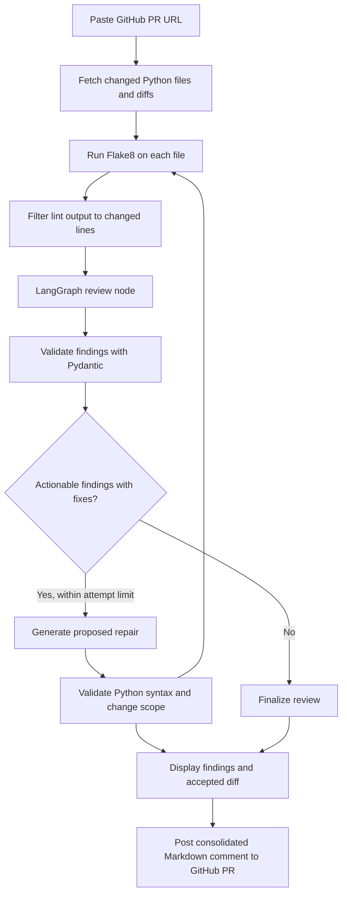

# AI PR Reviewer — Agentic Code Review & Repair

An LLM-powered Python pull-request assistant that reviews changed Python files, groups findings by category, proposes guarded code repairs, and publishes a structured Markdown review comment to GitHub.

**Live demo:** https://agentic-pr-reviewer.streamlit.app/  
**Repository:** https://github.com/Salaam7867/AI-PR-Reviewer

> **Important:** AI findings and suggested repairs require human review. The application displays proposed code changes in the Streamlit interface and posts review findings to the PR; it does **not** commit the generated fixes to the repository or merge pull requests.

## Features

- **GitHub pull-request ingestion:** Accepts a GitHub PR URL and retrieves changed Python files and their diffs through PyGithub.
- **Agentic review workflow:** Uses LangGraph to coordinate linting, LLM review, bounded repair attempts, and finalization.
- **LLM-powered analysis:** Uses Groq's API with the `openai/gpt-oss-120b` model to identify potential bugs, security concerns, and code-hygiene issues.
- **Structured findings:** Uses Pydantic models to validate finding fields and normalize severity labels.
- **Change-aware review:** Filters lint results and review findings against changed lines to reduce unrelated feedback.
- **Guarded repair preview:** Generates proposed Python fixes, checks syntax with Python's AST parser, and applies a scope check before displaying accepted changes.
- **GitHub feedback:** Publishes a consolidated Markdown review comment on the pull request.
- **Interactive interface:** Uses Streamlit to show findings, linter output, and a diff of proposed changes.

## How it works



### Main components

| File | Responsibility |
|---|---|
| `app.py` | Streamlit UI, PR review orchestration, repair-diff display, and posting workflow |
| `github_service.py` | Parse PR URLs, fetch changed Python files, and post review comments |
| `graph.py` | Define the LangGraph review, repair, and finalization workflow |
| `graph_nodes.py` | Implement lint filtering, LLM review, finding validation, and guarded repair logic |
| `graph_state.py` | Define the state shared between workflow nodes |
| `review_schema.py` | Define Pydantic models for categorized findings and severity normalization |
| `linter_tool.py` | Run Flake8 against Python files |
| `main.py` | Standalone code-review entry point for a local Python file |

## Tech stack

- **Language:** Python
- **UI:** Streamlit
- **Workflow orchestration:** LangGraph
- **LLM provider/model:** Groq API with `openai/gpt-oss-120b`
- **Validation:** Pydantic
- **GitHub integration:** PyGithub
- **Static linting:** Flake8
- **Configuration:** `python-dotenv`

## Run locally

### 1. Clone the repository

```bash
git clone https://github.com/Salaam7867/AI-PR-Reviewer.git
cd AI-PR-Reviewer
```

### 2. Create and activate a virtual environment

**Windows (PowerShell):**

```powershell
python -m venv .venv
.\.venv\Scripts\Activate.ps1
```

**macOS/Linux:**

```bash
python3 -m venv .venv
source .venv/bin/activate
```

### 3. Install dependencies

```bash
python -m pip install -r requirements.txt
python -m pip install flake8
```

Flake8 is required by `linter_tool.py`; install it explicitly because it is not currently listed in `requirements.txt`.

### 4. Configure environment variables

Create a file named `.env` in the project root:

```dotenv
GROQ_API_KEY=your_groq_api_key
GITHUB_TOKEN=your_github_token
```

- `GROQ_API_KEY` is used for LLM review and repair calls.
- `GITHUB_TOKEN` is used to read pull-request files and publish the review comment. Grant only the repository permissions needed for your intended use.

**Security:** Never commit `.env` or paste API tokens into source code, screenshots, issues, or logs. If a token is exposed, revoke it and create a replacement.

### 5. Start the application

```bash
python -m streamlit run app.py
```

Open the local URL shown in the terminal, paste a GitHub pull-request URL, and select **Run PR Review**.

## Using the application

1. Open a GitHub pull request that contains Python changes.
2. Copy its URL, for example `https://github.com/owner/repo/pull/123`.
3. Paste the URL into the Streamlit application.
4. Run the review and inspect the findings and lint output.
5. Review the proposed code diff carefully.
6. The application attempts to publish a consolidated review comment to the pull request using the configured GitHub token.

The application currently processes changed `.py` files; other file types are skipped.

## Limitations and safety notes

- LLM-generated findings can be incorrect, incomplete, or miss real defects. Treat the output as assistance, not as a security guarantee.
- Pydantic validates output structure and allowed field values; it does not prove that a finding is factually correct.
- AST parsing checks Python syntax, not runtime behavior, correctness, or regression safety.
- Scope guardrails are intended to limit unrelated edits, but they need comprehensive testing before being relied on for production changes.
- The current workflow displays accepted proposed fixes; it does not automatically commit them to a branch or merge the PR.
- GitHub API permissions, rate limits, repository access, and Groq quotas can affect execution.
- Review only code you are authorized to share with the configured LLM provider. PR code is sent to the provider for processing.

## Current project status

This is an actively developed project. The next engineering priorities are to expand automated tests for diff parsing and repair scope checks, verify failure handling, and document tested behavior with reproducible examples.

## License

No license file was included in the supplied project archive. Add a license before presenting the repository as open source, and choose terms that match how you want others to use the code.
